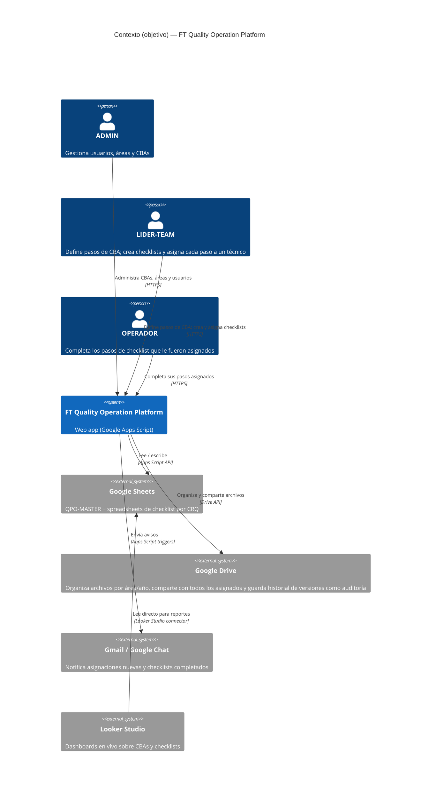
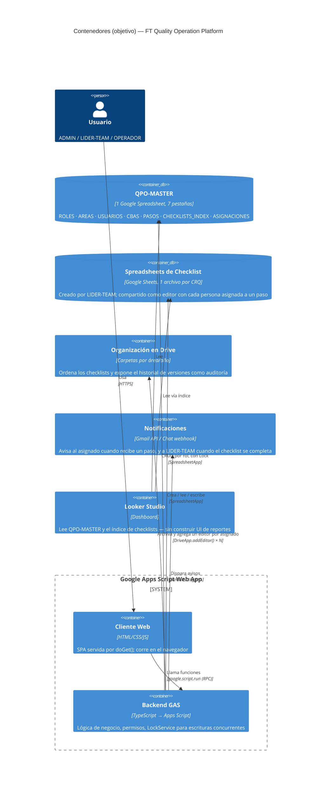
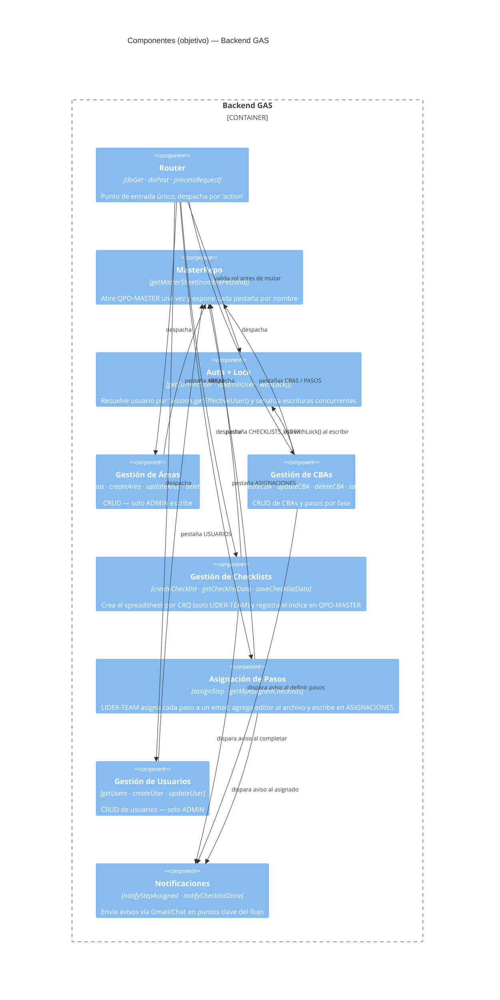

# Arquitectura Objetivo — FT Quality Operation Platform

> Modelo C4 de la arquitectura **objetivo**: plataforma nativa de Google Workspace para gestión de CBAs y checklists de cambio, pensada para ~12 operadores. No describe el estado actual del código — es el destino a construir.

## Principios de diseño

1. **Un único spreadsheet maestro, no siete archivos sueltos.** `ROLES`, `AREAS`, `USUARIOS`, `CBAS`, `PASOS`, el índice de `CHECKLISTS` y las `ASIGNACIONES` viven como pestañas de **un** archivo (`QPO-MASTER`). Con 12 usuarios, separarlos en archivos de Drive independientes solo agrega permisos que gestionar y una capa de indirección (hoy resuelta por un sheet "Maestro" que mapea nombre → ID) que deja de ser necesaria.
2. **Un spreadsheet por actividad, eso sí separado.** Cada checklist que se ejecuta sobre un CRQ sigue siendo su propio archivo — es el registro aislado, compartible y con historial propio de esa intervención puntual. No se mezcla con el maestro.
3. **Un checklist es multi-equipo, no de un solo dueño.** Un CRQ real puede involucrar a varios equipos técnicos. El LIDER-TEAM crea el checklist y asigna cada paso individual a la persona que le corresponde; el spreadsheet se comparte con todos los asignados, no solo con quien lo creó.
4. **Google Workspace como plataforma completa, no solo como almacenamiento.** Drive para organización y auditoría (historial de versiones), Gmail/Chat para notificaciones, Looker Studio para reportes — en vez de reconstruir a mano lo que Google ya resuelve.

---

## 1. Contexto del sistema

---

## 2. Contenedores

**Reemplaza:** el sheet "Maestro" que hoy solo indexa IDs (`loadSheetIds()`) desaparece — `backend` abre `QPO-MASTER` una vez por `MASTER_SHEET_ID` fijo y accede a cada tabla con `getSheetByName()`. Los checklists por CRQ mantienen su patrón actual de archivo independiente, que ya funciona bien para ese propósito — solo que ahora se comparten con varios editores en vez de uno.

**Control de acceso — decisión explícita:** Google Sheets no ofrece permisos nativos por fila. Se decidió **no** usar Protected Ranges: todo asignado es editor del archivo completo, y es el frontend (`client.html`) el que habilita solo los campos operativos de las filas donde su email coincide con el asignado del paso. No hay garantía a nivel de Drive de que alguien no edite una fila ajena — es una convención de UI, aceptada conscientemente por simplicidad de construcción.

---

## 3. Componentes del backend

---

## 4. Modelo de datos objetivo

### `QPO-MASTER` (un spreadsheet, siete pestañas)

| Pestaña | Contenido | Nota |
|---|---|---|
| **ROLES** | 3 roles fijos (ADMIN, LIDER-TEAM, OPERADOR) y sus permisos | Catálogo estático |
| **AREAS** | 12 áreas técnicas (código + nombre) | Código numérico consistente en toda la app |
| **USUARIOS** | email, nombre, rol, área, activo | Fuente de permisos por email |
| **CBAS** | Catálogo unificado de CBAs de todas las áreas | Columna `area_codigo` reemplaza el acoplamiento a "Networking" |
| **PASOS** | Pasos de cada CBA por fase | Relacionado a CBAS por `cba_id` |
| **CHECKLISTS_INDEX** | Un registro por checklist creado | Apunta al `spreadsheetId` del archivo real de esa actividad; `creado_por` es el LIDER-TEAM |
| **ASIGNACIONES** | Un registro por (checklist, paso, persona) | `checklist_id`, `paso_sec`, `email_asignado`, `fecha_asignacion` — es la tabla que responde "¿en qué checklists tengo pasos asignados?" |

### Spreadsheets de Checklist (uno por CRQ)

Se mantienen igual que hoy: cabecera con datos del cambio (CRQ, fechas, freezing), tabla de pasos agrupada por fase (PRE-INTERVENCIÓN / INTERVENCIÓN / POST-INTERVENCIÓN / RETORNO). La columna "Equipo Técnico" de cada fila pasa a ser el campo de asignación formal (antes era texto libre). Se archivan automáticamente en una carpeta de Drive `Checklists/{área}/{año}` en lugar de quedar sueltos en la raíz, y se comparten como editor con cada email presente en `ASIGNACIONES` para ese checklist.

---

## 5. Qué resuelve esta arquitectura

| Problema actual | Solución objetivo |
|---|---|
| 7 archivos de Drive + sheet "Maestro" de IDs | 1 archivo `QPO-MASTER` con pestañas, sin indirección |
| `CBAS_NETWORKING` acoplado a una sola área | `CBAS` unificado con `area_codigo` |
| Escrituras concurrentes sin protección | `LockService` en cada función de escritura |
| Sin auditoría | Historial de versiones nativo de Drive sobre `QPO-MASTER` |
| Nadie se entera de pasos pendientes / checklists completados | Notificaciones Gmail/Chat en los puntos clave |
| Un checklist solo tiene un dueño (`email_operador`), no sirve para CRQs multi-equipo | LIDER-TEAM asigna cada paso a una persona distinta vía `ASIGNACIONES`; el archivo se comparte con todos |
| Ver el estado global exige abrir archivo por archivo | Looker Studio conectado directo a `QPO-MASTER` + `CHECKLISTS_INDEX` |

---

*Diagramas en sintaxis C4 de Mermaid — se renderizan nativamente en GitHub/GitLab y en cualquier visor Mermaid.*
